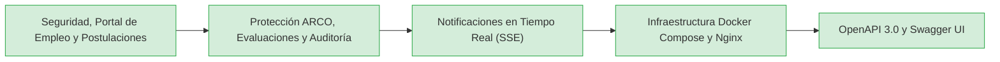

# 📊 Estado del Proyecto GTEL Talento ATS y Roadmap Oficial

**Fecha de Actualización:** 21 de Octubre de 2026  
**Estado General:** ✅ **100% COMPLETADO (Sistema Completo Listo para Sustentación)**  
**Rama Principal:** `main` | `develop`  
**Tests Backend:** 85/85 en verde (`BUILD SUCCESS`)  
**Frontend:** Compilación limpia Vite/React con proxy inverso Nginx  

---

## 🏗️ 1. MÓDULOS Y CAPACIDADES DEL SISTEMA



- ✅ **Módulos Principales de Negocio:** Autenticación con JWT y OTP por correo, roles RBAC (Admin, Reclutador, Jefatura, Analista, Entrevistador, Candidato), portal de empleo, proceso de selección, derechos ARCO (Ley 29733) y papelera de reciclaje temporal.
- ✅ **Tiempo Real:** Notificaciones push en tiempo real mediante Server-Sent Events (SSE) con componente de campana interactiva y toasts flotantes.
- ✅ **Despliegue y DevOps:** Contenerización y orquestación multi-contenedor con Docker y Docker Compose (MySQL 8 + Spring Boot + Nginx con reverse proxy).
- ✅ **Documentación Técnica:** Documentación técnica interactiva OpenAPI 3.0 con Swagger UI (`/swagger-ui.html`) y auditoría integral de calidad.

---

## 🚀 2. INSTRUCCIONES PARA LEVANTAR EL PROYECTO

### Opción A: Modo Desarrollo Local (Como siempre)

1. **MySQL:** Iniciar MySQL en XAMPP (puerto 3306).
2. **Backend (Spring Boot 3.5 con Java 21):**
   ```bash
   cd backend
   mvn spring-boot:run
   ```
   *Disponible en:* `http://localhost:8080`  
   *Documentación Swagger:* `http://localhost:8080/swagger-ui.html`
3. **Frontend (Vite + React 19):**
   ```bash
   cd frontend
   npm run dev
   ```
   *Disponible en:* `http://localhost:5173`

---

### Opción B: Modo Producción con Docker Compose (1 Solo Comando)

En la raíz del proyecto:
```bash
docker compose up -d --build
```
* **Aplicación Web:** `http://localhost`
* **Swagger API:** `http://localhost/swagger-ui.html` (o `http://localhost:8080/swagger-ui.html`)
* **Apagar:** `docker compose down`

---

## Cuentas de desarrollo

La instalación limpia prepara cuatro cuentas de demostración y guarda solo hashes BCrypt. Sus
contraseñas se distribuyen fuera del repositorio. No cargar estas cuentas en producción. OTP se
omite solo cuando `TEST_ACCESS_ENABLED=true`; por defecto el bypass está deshabilitado.
