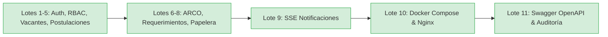

# 📊 Estado del Proyecto GTEL Talento ATS y Roadmap Oficial

**Fecha de Actualización:** 21 de Octubre de 2026  
**Estado General:** ✅ **100% COMPLETADO (Lotes 1 al 11 Listos para Sustentación)**  
**Rama Principal:** `main` | `develop`  
**Tests Backend:** 85/85 en verde (`BUILD SUCCESS`)  
**Frontend:** Compilación limpia Vite/React con proxy inverso Nginx  

---

## 🏗️ 1. HITOS Y LOTES COMPLETADOS



- ✅ **Lote 1 al 8:** Autenticación con JWT y OTP por correo, roles RBAC (Admin, Reclutador, Jefatura, Analista, Entrevistador, Candidato), portal de empleo, proceso de selección, derechos ARCO (Ley 29733) y papelera de reciclaje temporal.
- ✅ **Lote 9:** Notificaciones push en tiempo real mediante Server-Sent Events (SSE) con componente de campana interactiva y toasts flotantes.
- ✅ **Lote 10:** Contenerización y orquestación multi-contenedor con Docker y Docker Compose (MySQL 8 + Spring Boot + Nginx con reverse proxy).
- ✅ **Lote 11:** Documentación técnica OpenAPI 3.0 con Swagger UI interactivo (`/swagger-ui.html`) y auditoría integral de calidad.

---

## 🚀 2. INSTRUCCIONES PARA LEVANTAR EL PROYECTO

### Opción A: Modo Desarrollo Local (Como siempre)

1. **MySQL:** Iniciar MySQL en XAMPP (puerto 3306).
2. **Backend (Spring Boot 3.5 con Java 21):**
   ```bash
   cd backend
   mvn spring-boot:run
   ```
   *Disponible en:* `http://localhost:8080`  
   *Documentación Swagger:* `http://localhost:8080/swagger-ui.html`
3. **Frontend (Vite + React 19):**
   ```bash
   cd frontend
   npm run dev
   ```
   *Disponible en:* `http://localhost:5173`

---

### Opción B: Modo Producción con Docker Compose (1 Solo Comando)

En la raíz del proyecto:
```bash
docker compose up -d --build
```
* **Aplicación Web:** `http://localhost`
* **Swagger API:** `http://localhost/swagger-ui.html` (o `http://localhost:8080/swagger-ui.html`)
* **Apagar:** `docker compose down`

---

## 🔑 Credenciales de Acceso para Demostración

| Rol | Correo | Contraseña | Comportamiento OTP |
| :--- | :--- | :--- | :--- |
| **Administrador** | `administrador@gmail.com` | `AdminSecure2026*` | Ingreso directo (bypass test) |
| **Reclutador** | `reclutador1@gmail.com` | `Reclutador2026!` | Ingreso directo (bypass test) |
| **Postulante** | `postulante1@gmail.com` | `Postulante2026!` | Ingreso directo (bypass test) |
| **Jefatura Solicitante** | `jefatura1@gmail.com` | `Password123!` | Ingreso directo (bypass test) |
| **Analista RRHH** | `analista1@gmail.com` | `Password123!` | Ingreso directo (bypass test) |
| **Entrevistador** | `entrevistador1@gmail.com` | `Password123!` | Ingreso directo (bypass test) |
| **Usuarios Nuevos / Externos** | Cualquiera | Según registro | Exige código OTP de 6 dígitos por email |
