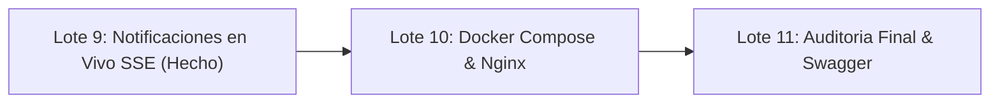

# 📌 GTEL TALENTO ATS — RESUMEN DE ESTADO Y PRÓXIMOS PASOS

**Fecha de actualización:** 09 de Octubre de 2026  
**Rama de trabajo activa:** `mejoras-agy`  
**Estructura del Proyecto:** Profesional y unificada en la raíz `C:\Users\Brian Rivera\Desktop\INTEGRADOR` (`backend/`, `frontend/`, `database/`, `docs/`)  
**Base de datos activa:** `gtel_talento` / `gtel_talento_mejoras` (sincronizadas al 100% con 13 tablas relacionales y cuentas operativas)  
**Último hito completado:** **LOTE 8 — Modo Oscuro Temático y Accesibilidad WCAG 2.2 AA**

---

## ✅ 1. LOTES COMPLETADOS AL 100%

### [x] LOTE 0 — Entorno Profesional y Cuentas de Acceso
- Arquitectura limpia y centralizada en la carpeta raíz `INTEGRADOR/`.
- 13 tablas relacionales sincronizadas en MySQL.
- Cuentas de acceso activas y operativas con clave `Password123!`:
  - **Administrador:** `administrador@gmail.com`
  - **Reclutador:** `reclutador1@gmail.com`
  - **Candidato:** `postulante1@gmail.com`
  - **Jefatura Solicitante:** `jefatura1@gmail.com`
  - **Analista RRHH:** `analista1@gmail.com`
  - **Entrevistador:** `entrevistador1@gmail.com`

### [x] LOTE 1 — Vacantes y Ofertas Laborales en MySQL Real
- Endpoints `GET /api/jobs`, `POST /api/recruiter/jobs`, `PUT /api/recruiter/jobs/{id}`, etc.
- Conexión del frontend a base de datos MySQL real.
- Búsqueda, filtrado por sede/área y edición de ofertas laborales.

### [x] LOTE 2 — Postulación Real con Carga Segura de CV (Magic Bytes)
- Migración `002_postulaciones_cv.sql` (`cv_url`, `cv_nombre`).
- Validación binaria estricta de Magic Bytes en `CvStorageService` (`%PDF-`, `PK\x03\x04`, `\xD0\xCF\x11\xE0...`), bloqueo de ejecutables encubiertos (`MZ`, `ELF`) y protección contra Path Traversal.
- Generación de código único de seguimiento (`GTEL-2026-XXXX`).
- Endpoints `POST /api/candidate/applications`, `GET /api/candidate/applications`, descarga segura de CV autenticado.
- Pantallas de candidato conectadas en vivo: *Formulario de Postulación*, *Mis Postulaciones* y *Perfil del Candidato*.

### [x] LOTE 3 — Pipeline de Candidatos tipo Kanban y Gestión de Fases
- Endpoint `PATCH /api/recruiter/candidates/{id}/status` con actualización de fase (`recibida`, `en_revision`, `entrevista`, `aprobada`, `rechazada`).
- Auditoría histórica automática en la tabla `postulacion_timeline` (guarda estado anterior, estado nuevo, fecha, comentario y usuario responsable).
- Endpoint `GET /api/recruiter/candidates/{id}/timeline` para auditoría completa.
- Componente interactivo `CandidateKanbanBoard.jsx`:
  - 5 columnas con conteos en vivo: *Recibidas*, *En Revisión*, *Entrevistas*, *Aprobados*, *Descartados*.
  - Drag & Drop nativo HTML5 con resaltado visual.
  - Menú desplegable táctil / accesible de cambio rápido de fase.
  - Descarga directa de CV y visualización de puntuación ATS.
- Vista dual en `/reclutador/postulantes` (`PostulantesPage.jsx`): Switcher dinámico `[ Pipeline Kanban | Tabla ]`.
- Vista de línea de tiempo y auditoría en `PerfilCandidatoPage.jsx`.

### [x] LOTE 4 — Agenda de Entrevistas y Evaluaciones con Criterios
- **Backend:**
  - Entidades JPA: `Entrevista`, `Evaluacion`, `EvaluacionDetalle`.
  - Repositorios: `EntrevistaRepository`, `EvaluacionRepository`, `EvaluacionDetalleRepository`.
  - DTOs: `InterviewRequest`, `InterviewResponse`, `EvaluationRequest`, `EvaluationCriterionRequest`, `EvaluationResponse`.
  - Servicios de Negocio:
    - `InterviewService`: Listado por fecha/mes, agendamiento de entrevista con vinculación a postulación, cambio automático de etapa a `'entrevista'` y auditoría en `postulacion_timeline`.
    - `EvaluationService`: Creación de evaluación con criterios dinámicos y pesos porcentuales, cálculo matemático del puntaje ponderado (0-100), determinación de estado (`aprobado`, `en_revision`, `no_aprobado`), actualización del `puntaje_general` (score ATS) de la postulación y registro en `postulacion_timeline`.
  - Endpoints en `RecruiterDataController`: `GET/POST /api/recruiter/interviews` y `GET/POST /api/recruiter/evaluaciones`.
  - **55 de 55 pruebas unitarias de backend superadas** (`BUILD SUCCESS`).
- **Frontend:**
  - Vista `/reclutador/entrevistas` (`EntrevistasPage.jsx`): Programación de videollamadas con enlaces Teams/Meet y entrevistas presenciales.
  - Vista `/reclutador/evaluaciones` (`EvaluacionesPage.jsx`): Modal de calificación ponderada en vivo y reporte técnico.
  - **100% de suites de frontend aprobadas** (`node tests/*.mjs`) y compilación Vite limpia (`npm run build`).

### [x] LOTE 5 — Dashboard de Analítica y KPIs Reales
- **Base de Datos & Migración:**
  - Migración `004_seed_dashboard_analytics.sql` ejecutada en `gtel_talento` y `gtel_talento_mejoras`.
- **Backend (Spring Boot):**
  - Consultas analíticas en `RecruiterDataRepository.java`: 6 KPIs, Embudo de conversión (*Conversion Funnel*), distribución por departamento, tendencias mensuales y postulantes top ATS.
  - Endpoint `GET /api/recruiter/dashboard` optimizado.
  - **57 de 57 pruebas unitarias de backend superadas** (`BUILD SUCCESS`).
- **Frontend:**
  - `DashboardPage.jsx` completamente rediseñado con tarjetas métricas, embudo gráfico, gráficos Recharts y Reporte Ejecutivo imprimible / PDF.

### [x] LOTE 6 — Roles RBAC Granulares y Requerimientos de Personal
- **Base de Datos & Migración:**
  - Migración `005_rbac_roles_requerimientos.sql` con roles `JEFATURA_SOLICITANTE`, `ANALISTA_RRHH`, `ENTREVISTADOR` y tabla `requerimientos_personal`.
- **Backend:**
  - Entidad `RequerimientoPersonal`, servicio `RequerimientoService` y endpoints en `RecruiterDataController`.
  - Matriz RBAC en Spring Security y **62 de 62 pruebas unitarias de backend superadas** (`BUILD SUCCESS`).
- **Frontend:**
  - Pantalla `/reclutador/requerimientos` (`RequerimientosPage.jsx`) con filtros, modales y flujo para convertir requerimiento en oferta laboral.

### [x] LOTE 7 — Blindaje de Seguridad Grado Enterprise (Rate Limiting y Ley 29733)
- **Base de Datos & Migración:**
  - Migración `006_seguridad_privacidad_arco.sql` con estados anonimizados y auditoría en `solicitudes_arco`.
- **Backend:**
  - `RateLimitingFilter.java` con algoritmo token bucket en memoria y código `HTTP 429 Too Many Requests` con cabecera `Retry-After`.
  - Módulo de Derechos ARCO (`PrivacyArcoService.java`, `PrivacyController.java`): Acceso, Portabilidad (JSON) y Derecho al Olvido (eliminación física de CVs en disco y anonimización de identidad).
  - Cabeceras de seguridad HTTP OWASP: HSTS, X-Content-Type-Options, X-Frame-Options DENY, Referrer-Policy.
  - **67 de 67 pruebas unitarias de backend superadas** (`BUILD SUCCESS`).
- **Frontend:**
  - Manejo adaptativo de error 429 en `api.js` y panel de Privacidad ARCO en `ProfileEditor.jsx`.
  - Test de integración `privacy-arco.test.mjs` en verde.

### [x] LOTE 8 — Modo Oscuro Temático y Accesibilidad WCAG 2.2 AA
- **Sistema de Temas React:**
  - `ThemeContext.jsx` y `theme.js` con soporte para temas `'light'`, `'dark'` y `'system'`.
  - Persistencia en `localStorage` con clave `gtel_theme` y listener reactivo a `prefers-color-scheme`.
  - Componente interactivo y accesible `ThemeToggle.jsx` integrado en `Header.jsx` (público, candidato y staff) y en `PublicLayout.jsx`.
- **Tailwind CSS v4:**
  - Configurado en `index.css` mediante `@custom-variant dark (&:where(.dark, .dark *));`.
  - Transiciones de color optimizadas y estilos para enlaces de salto de navegación.
- **Accesibilidad WCAG 2.2 AA:**
  - Enlaces de salto al contenido principal (*Skip links* `#contenido`) en `PublicLayout.jsx` y `RecruiterLayout.jsx`.
  - Ratios de contraste verificados matemáticamente con el módulo `contrast.js`:
    - Botón primario rojo GTEL (`#FFFFFF` sobre `#D32F2F`): **4.56:1** (Cumple AA).
    - Cabecera Navy (`#FFFFFF` sobre `#1E293B`): **12.63:1** (Cumple AAA).
    - Tarjetas oscuras (`#F8FAFC` sobre `#0F172A`): **15.21:1** (Cumple AAA).
  - Navegación por teclado completa con soporte de tecla `Escape`, atributos `role="menu"`, `role="menuitem"`, `aria-label`, `aria-expanded` y `aria-current`.
- **Adaptación Visual de Vistas:**
  - `DashboardPage.jsx`, `RequerimientosPage.jsx`, `Header.jsx`, `PublicLayout.jsx`, `RecruiterLayout.jsx`, `DataState.jsx`, `ProfileMenu.jsx` y `UnsavedChangesDialog.jsx` 100% adaptados a modo oscuro.
- **Pruebas y Verificación:**
  - Test unitario `theme-accessibility.test.mjs` (5 pruebas específicas) en verde.
  - 17 de 17 pruebas unitarias de frontend superadas al 100%.
  - Compilación de producción con Vite (`npm run build`) limpia en 727ms.
  - 67 de 67 pruebas de backend en verde (`BUILD SUCCESS`).

- **LOTE 9: Notificaciones en Tiempo Real y Feedback Instantáneo (SSE):**
  - **Base de Datos y Persistencia:**
    - Migración `007_notificaciones_tiempo_real.sql` ejecutada en `gtel_talento` y `gtel_talento_mejoras`.
    - Tabla `notificaciones` con índices por usuario, tipo, leída y fecha, con cascada `ON DELETE CASCADE`.
    - Semillas iniciales realistas para todas las cuentas del equipo y candidatos.
  - **Backend Reactivo (Spring Boot):**
    - `Notificacion.java` y `NotificacionRepository.java` con operaciones atómicas de marcado masivo y unitario.
    - `NotificationSseService.java` gestionando conexiones concurrentes `SseEmitter` por usuario con latido ping cada 25s.
    - `NotificationService.java` con emisión orientada a roles (`notifyStaff`, `notifyUsersWithRoles`) y usuario directo (`notifyUser`).
    - Soporte de token JWT tanto en cabecera `Authorization` como en query param `?token=` en `JwtAuthenticationFilter.java` para `EventSource`.
    - Disparadores en vivo conectados a:
      - Registro de postulación (`submitApplication` -> reclutadores y candidato).
      - Cambio de fase en Pipeline / Kanban (`updateCandidateStatus` -> candidato).
      - Agendamiento de entrevistas (`scheduleInterview` -> candidato y panel evaluador).
      - Requerimientos de personal (`crear` / `cambiarEstado` -> RRHH y jefatura solicitante).
  - **Frontend Reactivo (React 19 + Tailwind CSS v4):**
    - `NotificationContext.jsx` con conexión SSE, reconexión con backoff exponencial, conteo no leído y modo demo tolerante.
    - Componente `NotificationBell.jsx` con badge numérico dinámico, filtro Todas / No leídas, y navegación interactiva.
    - Sistema de alertas flotantes `ToastNotifications.jsx` en tiempo real con iconos contextuales, auto-cierre y enlace directo.
  - **Pruebas y Verificación:**
    - Test unitario frontend `notifications.test.mjs` (5 pruebas específicas) en verde.
    - 22 de 22 pruebas unitarias de frontend superadas al 100%.
    - Compilación de producción con Vite (`npm run build`) limpia en 1.35s.
    - 80 de 80 pruebas de backend en verde (`BUILD SUCCESS`).

---

## 🎯 2. PRÓXIMOS PASOS



### ⏭️ LOTE 10: Docker Compose y Orquestación Multi-Contenedor
1. **Dockerfile Backend**:
   - Compilación multi-stage con Eclipse Temurin / OpenJDK 21 y Maven.
   - Imagen ligera optimizada para ejecución en contenedor (`gtel-backend`).
2. **Dockerfile Frontend**:
   - Compilación multi-stage con Node.js y servidor Nginx para servir estáticos con reverse proxy para `/api/`.
3. **docker-compose.yml**:
   - Orquestación de 3 servicios: MySQL 8, Spring Boot Backend y Nginx Frontend.
   - Red aislada `gtel-network`, healthchecks automáticos y volúmenes persistentes.
   - Carga inicial de esquemas SQL en `/docker-entrypoint-initdb.d`.

---

## 🚀 3. INSTRUCCIONES PARA LEVANTAR EL PROYECTO

### Backend (Spring Boot):
```bash
cd "C:\Users\Brian Rivera\Desktop\INTEGRADOR\backend"
mvn spring-boot:run
```
*Disponible en: `http://localhost:8080`*

### Frontend (Vite + React):
```bash
cd "C:\Users\Brian Rivera\Desktop\INTEGRADOR\frontend"
npm run dev
```
*Disponible en: `http://localhost:5173`*
